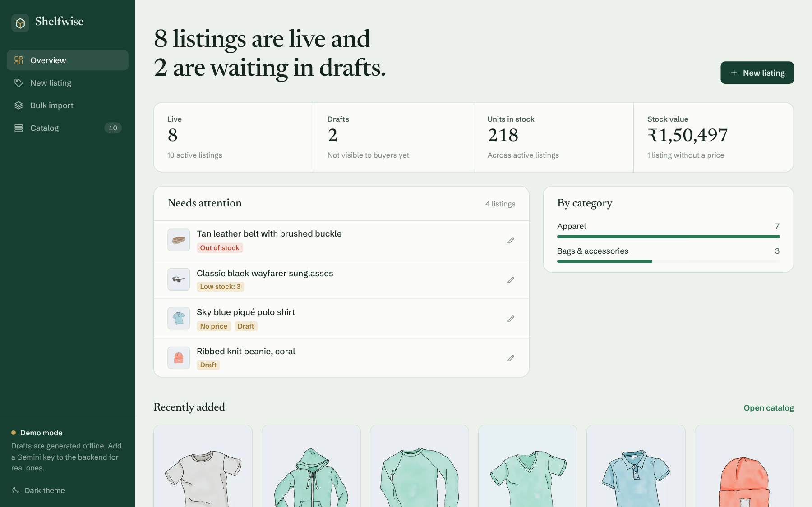
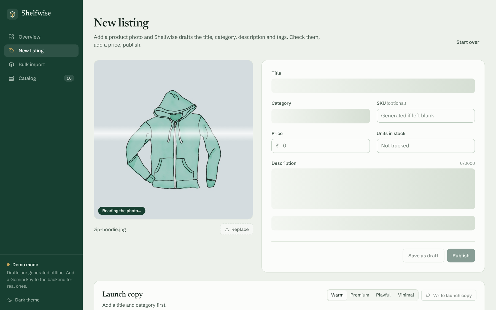
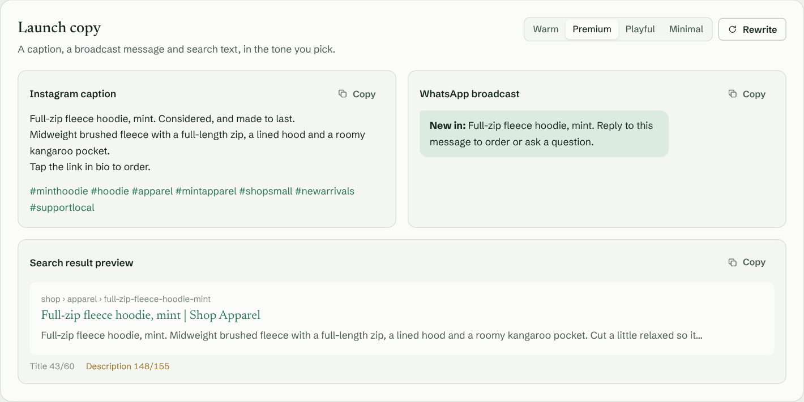
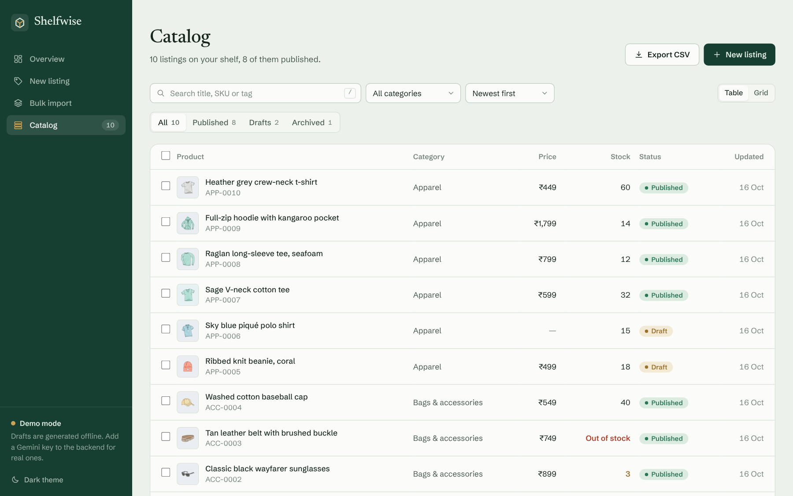
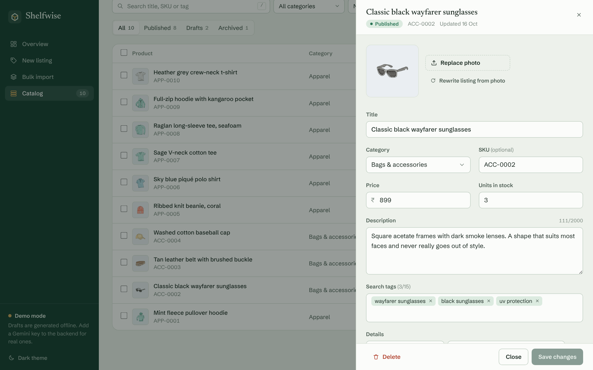
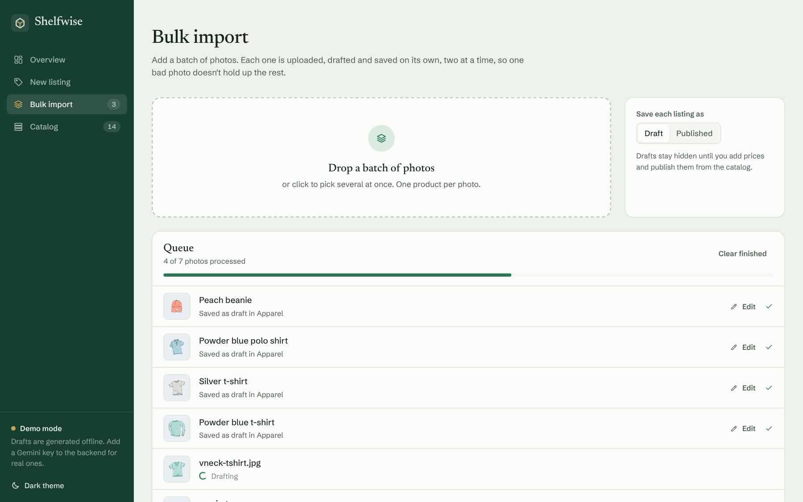
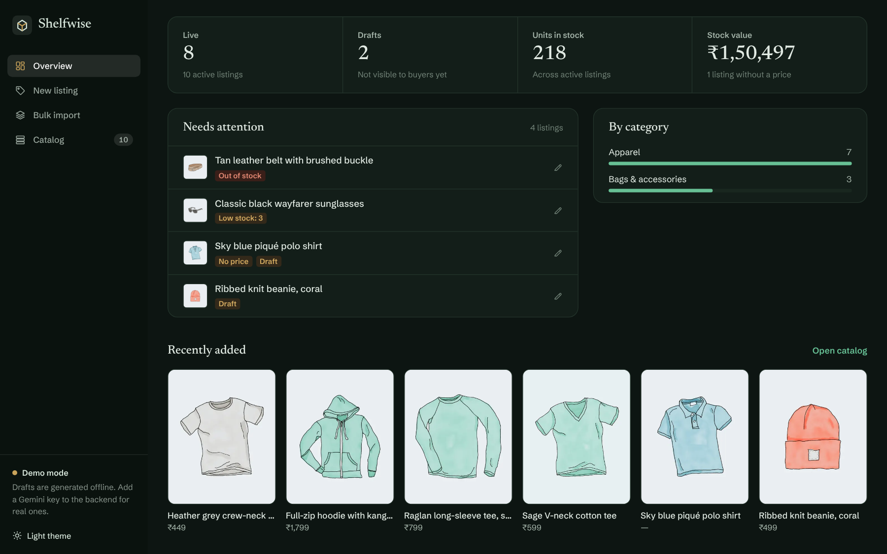
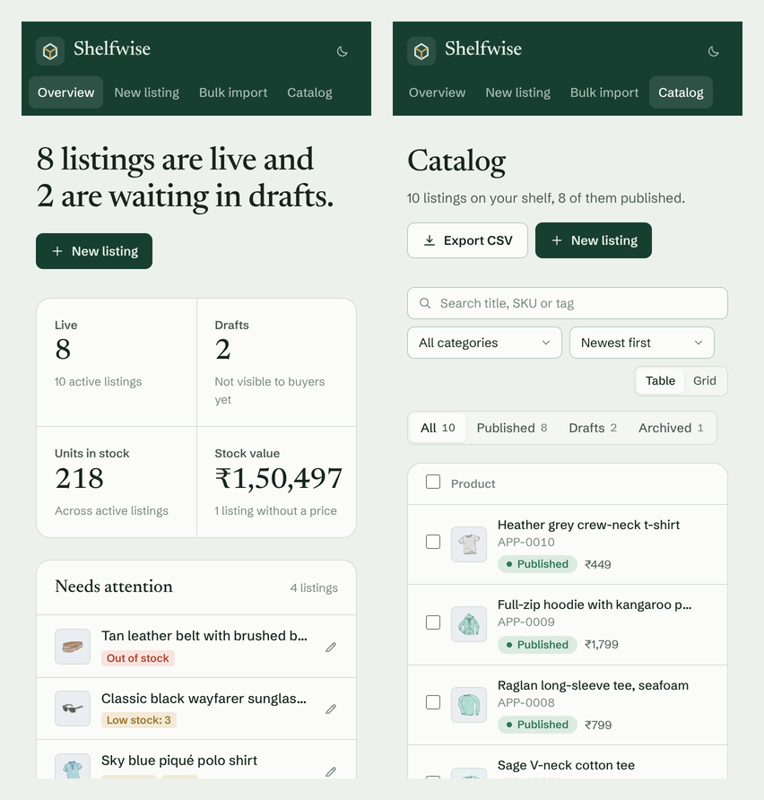
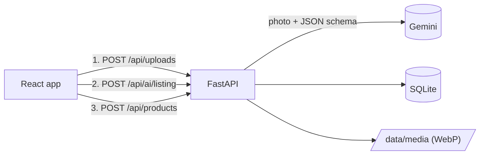

# Shelfwise

A catalog tool for small online sellers. Drop in a product photo and it drafts the listing for you: title, category, description, search tags and a few visible details. You fix what's off, add a price and stock, and publish. It also writes the launch copy (Instagram caption, WhatsApp broadcast, search snippet) and keeps an eye on listings that need attention.

React + TypeScript on the front, FastAPI + SQLite on the back, Gemini for the vision part. It also runs without an API key in a demo mode, so you can try the whole thing locally in a couple of minutes.



## Why

Writing listings is the slow part of putting products online. Taking forty photos takes an afternoon; turning them into forty decent titles and descriptions takes the rest of the week. A vision model is good at the boring 80% of that (what is this, what colour, what would someone search for), as long as a person stays in charge of the result. So every draft lands in an editable form instead of going straight to the shop.

## Features

- **Draft from a photo.** Upload, drag and drop, or paste from the clipboard. The listing fields fill in while the photo is being read.
- **Bulk import.** Drop a batch of photos; each one is uploaded, drafted and saved on its own, two at a time, with per-photo progress and retry.
- **Catalog.** Table and grid views, search (press `/`), category and status filters, sorting, multi-select to publish, unpublish, archive or delete.
- **Edit panel.** Change anything, swap the photo, or redraft the listing from the current photo. Asks before throwing away unsaved changes.
- **Launch copy.** Instagram caption with hashtags, a WhatsApp broadcast message and an SEO title/description, in four tones, with a live search-result preview and character counts.
- **Overview.** What's live, what's in drafts, units and stock value, a "needs attention" list (out of stock, low stock, no price, no photo, still a draft) and a category breakdown.
- **CSV export** of the whole catalog or the current filter, Excel-friendly.
- **Light and dark themes**, keyboard focus states, reduced-motion support, works on a phone.

| New listing | Launch copy |
| --- | --- |
|  |  |
| **Catalog** | **Edit panel** |
|  |  |
| **Bulk import** | **Dark theme** |
|  |  |

<p align="center"></p>

## How it works



Creating a listing is three separate requests: upload the photo, ask for a draft, save the product. Keeping them apart means a failed or slow AI call never loses the upload, and the seller can still fill the form in by hand.

```
backend/
  app/
    main.py          app factory, error handlers, static media
    config.py        settings from the environment
    database.py      SQLite connection and migrations
    catalog.py       product queries
    media.py         image validation, resizing, storage
    schemas.py       request/response models
    routers/         products, uploads + AI, health/meta
    writers/         GeminiWriter, DemoWriter, prompts
  tests/
frontend/
  src/
    pages/           Overview, NewListing, BulkImport, Catalog
    components/      form, drawer, launch copy, dropzone, ...
    stores/          catalog, bulk queue, toasts, theme, route
    lib/             API client, formatting, listing helpers
```

### Decisions worth explaining

- **Structured output, not string parsing.** The model gets a JSON schema with the category list as an enum. The first version asked for JSON in the prompt and stripped markdown fences off the reply, which broke often enough to matter. Whatever comes back still goes through a cleanup step (tag normalisation, length limits, category fallback) before the UI sees it.
- **Bulk import runs in the browser.** One big multipart request with twenty photos is fragile behind proxies and free-tier hosting, and gives no feedback. A small queue with a concurrency of 2 shows progress per photo, lets one failure be retried on its own, and is gentler on Gemini's per-minute rate limit.
- **Demo mode.** Without `GEMINI_API_KEY` the backend swaps in a writer that guesses from the file name and the photo's colours (ignoring the backdrop). It's obviously not a vision model and the UI says so, but it means the app runs anywhere and the API tests don't need a network.
- **Photos.** Uploads are checked by decoding them (not by trusting the extension), rotated according to EXIF, flattened onto white if transparent, and stored as WebP at two sizes. File names are random, so they're served with `Cache-Control: immutable`. Photos that were uploaded but never saved to a product are removed at startup once they're a day old.
- **Money is stored as integer paise/cents**, and formatted with `Intl.NumberFormat` on the client (₹ by default, configurable).
- **Migrations without a framework.** `PRAGMA user_version` plus a list of functions. Version 1 is the single table the first release shipped with, so an old database upgrades in place. Each migration runs in a transaction, DDL included.
- **CSV export** adds a BOM so Excel reads UTF-8 correctly, and prefixes cells starting with `=`, `+`, `-` or `@` so a product title can't run as a formula.
- **No state library on the frontend.** The catalog, bulk queue and toasts are tiny stores read with `useSyncExternalStore`, which is enough here and keeps the queue alive when you switch pages.

## Running locally

You need Python 3.11+ and Node 20.19+ (or 22).

**Backend**

```bash
cd backend
python -m venv .venv
source .venv/bin/activate          # Windows: .venv\Scripts\activate
pip install -r requirements-dev.txt
cp .env.example .env               # add GEMINI_API_KEY, or leave it empty for demo mode
uvicorn main:app --reload
```

The API runs on http://127.0.0.1:8000 and the interactive docs are at `/docs`.

**Frontend**

```bash
cd frontend
npm install
npm run dev
```

Open http://localhost:5173. In development Vite proxies `/api` and `/media` to the backend, so there's nothing else to configure.

### Configuration

Backend (`backend/.env`):

| Variable | Default | |
| --- | --- | --- |
| `GEMINI_API_KEY` | empty | Empty means demo mode. Get one at [aistudio.google.com](https://aistudio.google.com/apikey). |
| `GEMINI_MODEL` | `gemini-flash-latest` | Any Gemini model that takes images and supports JSON output. |
| `ALLOWED_ORIGINS` | `http://localhost:5173,...` | Comma-separated frontend origins for CORS. |
| `DATA_DIR` | `backend/data` | Where the database and photos live. |
| `MAX_UPLOAD_MB` | `8` | |
| `AI_TIMEOUT_SECONDS` | `45` | |
| `DEMO_MODE` | `false` | Force demo mode even with a key set. |

Frontend (`frontend/.env.local`):

| Variable | Default | |
| --- | --- | --- |
| `VITE_API_URL` | empty | The API's origin in production, e.g. `https://shelfwise-api.onrender.com`. |
| `VITE_CURRENCY` | `INR` | ISO currency code. |
| `VITE_LOCALE` | `en-IN` | Used for number, currency and date formatting. |

## API

| Method | Path | |
| --- | --- | --- |
| `GET` | `/api/health` | Liveness check |
| `GET` | `/api/meta` | Categories, AI mode, upload limit |
| `POST` | `/api/uploads` | Upload a photo (multipart `file`), returns its id and URLs |
| `POST` | `/api/ai/listing` | Draft a listing for an uploaded photo |
| `POST` | `/api/ai/marketing` | Write launch copy in a given tone |
| `GET` | `/api/products` | List, with `q`, `category`, `status`, `sort`, `limit`, `offset` |
| `POST` | `/api/products` | Create |
| `GET` | `/api/products/{id}` | Read one |
| `PATCH` | `/api/products/{id}` | Partial update |
| `DELETE` | `/api/products/{id}` | Delete, along with its photo |
| `POST` | `/api/products/bulk` | `publish`, `draft`, `archive` or `delete` up to 500 ids |
| `GET` | `/api/products/export.csv` | CSV export, same filters as the list |

Errors use FastAPI's usual `{"detail": ...}` shape. Apart from request validation errors, the detail is a sentence written to be shown in the UI as is.

## Tests and checks

```bash
cd backend && pytest && ruff check . && ruff format --check .
cd frontend && npm run lint && npm run build
```

The backend suite covers uploads (bad files, size limit, EXIF rotation, transparency), the demo writer, the Gemini writer against a fake client (parsing, refusals, quota and key errors), product CRUD and validation, bulk actions, CSV export and the v1-to-v2 migration, including rollback. GitHub Actions runs everything on each push.

## Deploying

The repo has a `render.yaml` for the API: create a Blueprint on Render, then set `GEMINI_API_KEY` and `ALLOWED_ORIGINS` (your frontend URL). The frontend is a static build: on Vercel or Netlify set the root to `frontend` and add `VITE_API_URL`.

One thing to know: SQLite and the uploaded photos live on local disk. Render's free instances have an ephemeral filesystem, so data resets on each deploy unless you attach a persistent disk and point `DATA_DIR` at it.

## Limitations and next steps

- There are no accounts. It's built as a single-seller tool; auth and per-seller data would come before anything multi-user.
- Photos should move to object storage (S3 or R2) for a real deployment.
- The catalog loads up to 500 products and filters in the browser, which is instant for a small shop. The API already supports server-side filtering and paging for when that stops being enough.
- Category and attribute guesses are still guesses. That's why nothing is published without a person looking at it, unless you choose that in bulk import.
- Marketplace-specific exports (Shopify, Amazon flat files) would be the most useful next feature.

## Credits

Fonts: [Newsreader](https://fonts.google.com/specimen/Newsreader) and [Schibsted Grotesk](https://fonts.google.com/specimen/Schibsted+Grotesk), both under the SIL Open Font License (licence files are in `frontend/public/fonts`). The product illustrations in the screenshots come from WooCommerce's sample data.
